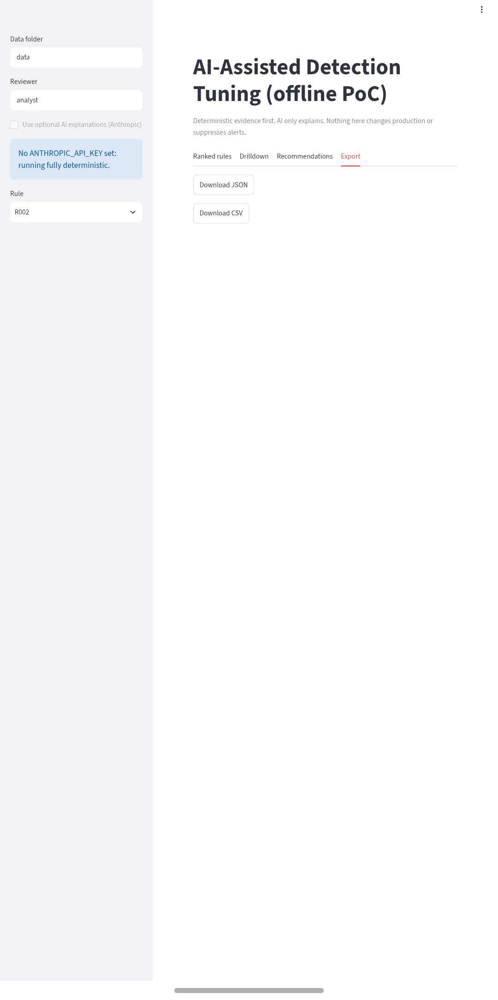

# DetectTuner

**Offline, evidence-grounded tuning recommendations for noisy security detection rules.**

DetectTuner is a Python proof of concept that analyses historical Microsoft Sentinel / Defender XDR-style security data, finds noisy detection rules and recurring benign patterns, and proposes **narrowly scoped tuning candidates**, while flagging anything that could weaken detection coverage.

> **Safety first:** DetectTuner only *recommends*. It never changes rules, suppresses alerts, or executes KQL. Every recommendation needs human review.

All data is **synthetic**. This is an independent portfolio project, not connected to any real environment or client.

## What it does

- **Ingests** five datasets (rules, events, alerts, incidents, investigation outcomes) from CSV/Parquet
- **Validates** schemas, types, timestamps and cross-references, and reports broken links explicitly
- **Preserves provenance**: every record keeps its source dataset, source row and ingestion timestamp
- **Ranks noisy rules** with documented, deterministic logic
- **Profiles recurring** users, IPs, devices, processes, resources and combinations
- **Generates narrow tuning candidates** and measures historical impact
- **Reports event impact and alert impact separately**
- **Flags** malicious overlap, unknown outcomes and over-broad exclusions
- **Streamlit dashboard** with Accept / Reject / Investigate review and JSON/CSV export
- **Optional AI explanations** (Anthropic) whose claims are validated against the evidence; works fully without an API key

## Safety rules built into the logic

| Situation | Behaviour |
|---|---|
| Candidate matches any known malicious record | Verdict `unsafe`; can never be accepted |
| Matched events have unknown or missing outcomes | Verdict `needs_investigation`; never reported as a false positive |
| Candidate matches 90% or more of a rule's events | Flagged `broad_scope` |
| AI invents a number, citation or verdict | AI text is hidden; the deterministic recommendation is kept |
| Instruction-like text inside telemetry (prompt injection) | Treated as untrusted data and flagged |
| KQL | Always labelled review-only; never executed |

## Mandatory test scenarios

| Scenario | Data | Expected result |
|---|---|---|
| **A**: recurring benign management activity | `svc_mgmt` on `SRV-MGMT-01`, 60 events, all benign | Narrow candidate, `supported_candidate`; 60 events (80%) but 30 alerts (66.67%) |
| **B**: frequent entity, benign and malicious records | `svc_backup`: 40 benign, 4 malicious | Broad `user` exclusion is `unsafe`; narrower `user+ip+device` is supported |
| **C**: frequent entity, unknown outcomes | `svc_unknown`: 30 events, no confirmed outcome | `needs_investigation`; no invented benign labels |

## Noisy-rule score

```
noise_score = benign_alerts + 0.5 × unknown_alerts
```
Malicious alerts add nothing. Rules are ranked by score (descending), then `rule_id` (ascending), so repeated runs give identical rankings.

## Architecture

```
CSV/Parquet → ingest (validate, normalise, provenance)
            → metrics (labels, per-rule counts, noise ranking)
            → patterns (recurring entities, candidates, impact, safety)
            → export (JSON schema, review workflow, CSV/JSON)
            → Streamlit dashboard
            → optional AI explanation (validated against evidence)
```

## Project structure

```
dtune/
  datagen.py   synthetic fixtures (scenarios A, B, C and a prompt-injection record)
  ingest.py    loading, validation, normalisation, provenance
  metrics.py   outcome labelling, rule metrics, noisy-rule ranking
  patterns.py  recurring patterns, candidates, impact, safety verdicts
  export.py    JSON schema, review decisions, JSON/CSV export
  ai.py        optional grounded-AI layer and validators
  cli.py       command-line interface
reference/refs.json   small curated, versioned reference list (MITRE ATT&CK, Sigma, Microsoft Learn)
tests/test_all.py     18 automated tests
app.py                Streamlit dashboard
```

## How to run (free, on a phone or laptop)

1. Open the notebook in Google Colab:
   [Open DetectTuner.ipynb in Colab](https://colab.research.google.com/github/fauzia-annisa/DetectTuner/blob/main/DetectTuner.ipynb)
2. Run cells 1 to 12. This builds the package, generates the synthetic data, runs the CLI and runs the tests.
3. Expected result: ranking `R002, R001, R003, R004, R005`, 6 recommendations, **18 tests passed**.
4. Run the dashboard cell to get a public link (it may need a re-run if the tunnel fails).

Command line:
```bash
python -m dtune.cli generate     # create synthetic datasets in data/
python -m dtune.cli run          # ingest, analyse, export to out/
python -m pytest -q              # run the tests
streamlit run app.py             # launch the dashboard
```

The optional AI layer needs `ANTHROPIC_API_KEY` set. Without it, everything runs deterministically.

## Design decisions

- **Unknown is not benign.** Missing or unknown outcomes stay unknown and lower confidence.
- **Most conservative label wins** when one event appears in several alerts (malicious > unknown > benign).
- **Narrowest predicate wins** among candidates that match the same historical events.
- **Events are not alerts.** Several events can group into one alert, so the impacts are measured separately.
- **AI explains, it doesn't decide.** Deterministic code produces every metric and verdict. AI output is validated against them before display.

## Limitations

- Synthetic data only; no live Sentinel or Defender integration
- No ML baselines or UEBA, no automatic rule changes or alert suppression
- No full KQL replay; KQL is generated for human review only
- The AI grounding check compares numbers, verdicts and citations. It is not a full fact-checker.
- Reference URLs should be re-verified before reuse

## Screenshots

**Scenario B: unsafe exclusion flagged, narrow candidate supported**


**Noisy rules ranked deterministically**


**Drilldown with traceable source evidence**


**JSON/CSV export**


